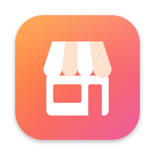

<p align="center"></p>

<h1 align="center">Vitrin</h1>

<p align="center">Your store listing, built from your code, and your whole <b>App Store Connect</b> in one Mac app.</p>

<p align="center">
  <a href="https://github.com/ardasnturk/vitrin/releases/latest"></a>
  <a href="https://github.com/ardasnturk/vitrin/actions/workflows/ci.yml"></a>
  
  <a href="LICENSE"></a>
</p>

<p align="center"><a href="https://vitrin.ardasnturk.com">Website</a> · <b>English</b> · <a href="README.tr.md">Türkçe</a></p>

> Vitrin is an independent open-source project. It is not affiliated with, endorsed by, or sponsored by Apple Inc. App Store, App Store Connect, iPhone, iPad and other Apple marks are trademarks of Apple Inc.

Vitrin is an app and a Claude Code plugin that share one pipeline:

* **Vitrin for Mac** — a native app that manages every app on your team through the [asc CLI](https://github.com/rorkai/App-Store-Connect-CLI): release status, store text, screenshots, builds, TestFlight, reviews, prices and analytics. It also runs the store listing pipeline for your projects, in ten languages.
* **The `/vitrin` skill** — inside Claude Code, it reads a mobile app project, researches competitors and keywords, and produces what a store listing needs: ASO-friendly metadata, screenshots, product page and App Preview creatives. Claude makes the creative decisions; the CLI collects, renders, validates and uploads, and only what you approved.

Apple's rules as of October 2026, and the points that could not be verified, are documented in [apple-notes.md](plugins/vitrin/skills/vitrin/references/apple-notes.md).

## Features

- **Project and platform detection** — native Xcode, Flutter, React Native, Expo and native Android projects; every platform the app ships on (iPhone, iPad, iPhone Duo, macOS incl. Mac Catalyst, watchOS, tvOS, visionOS, Android) with evidence. You pick the platforms for each run from that list.
- **Project analysis** — reads `.pbxproj`, `Info.plist`, entitlements, String Catalogs, asset catalogs, StoreKit configuration, App Intents, `pubspec.yaml`, `app.json`, Gradle files, Android resources and code signals to build an app profile with evidence-backed features.
- **Competitor and keyword research** — iTunes Search/Lookup, RSS top charts and reviews (cached, rate-limited), macOS Vision OCR of competitor screenshots, k-means color palettes, and keyword scoring (relevance × popularity × competition), the app's own rank per term and what its live listing says today. `vitrin write` checks the fields against the keyword plan (selected terms present, ranked terms kept, storefront-shared locales not repeating each other) and `vitrin rank` measures the result afterwards. Optional Apple Ads and AppTweak providers.
- **Metadata** — validates Claude-written App Store fields (name, subtitle, keyword field, description, promotional text, release notes: grapheme and UTF-8 byte counts, duplicates, forbidden terms, competitor brands, claim-to-evidence checks) and the Google Play listing (title, short and full description, changelog, Play metadata policy), and exports them to `metadata/store/metadata/` (the store metadata tree; supply reads its Android part).
- **Screens from the code, 1:1, no build** — by default Claude reads the app's views, whatever they are written in (SwiftUI, UIKit, Compose, Android XML, Flutter, React Native), and recreates each screen worth showing in HTML/CSS with measured spacing, the app's colors and fonts, realistic demo data and the app's own UI texts (`metadata/screens/`), starting from a native UI kit (iOS, Material 3, watchOS, macOS). Vitrin renders them per language and device at the exact screen size, with a 9:41 status bar. No Xcode build, no simulator, no demo mode.
- **Ready-made device mockups** — `vitrin mockups` renders transparent templates with their screen rectangles for iPhone, iPad, iPhone Duo (closed, open with its fold, and both together), Apple Watch, Mac (laptop and window), Apple TV, Vision Pro and Android phone and tablet, and places the app's rendered screens into them (`metadata/mockups/`). The screenshots use the same frames.
- **Real capture (optional)** — `capture.mode: launch-args` builds the app per platform (xcodebuild, `flutter build`, CocoaPods + xcodebuild, `expo prebuild`, Gradle) and captures raw screens in dedicated simulators (9:41 status bar, per-locale language), the Mac app window, or an Android emulator in System UI demo mode.
- **Screenshots** — HTML templates rendered with Playwright, following a proven App Store design method: 16 style presets tinted with your brand colors and combinable (emphasis treatments, tag kickers, color-blocked sets), benefit checklists, brand lockups and the developer's own photos as scenes, headline-first layouts with mixed emphasis, varied device framing (bleed, tilted, two devices, no device), realistic CSS device frames for every family (iPhone, iPad, Duo, Mac, Watch, TV, Vision Pro, Android phone and tablet), Google Play feature graphic and icon templates, RTL, exact pixel sizes without alpha. Claude designs for each app instead of only picking presets: bespoke art directions (own palette, type and device treatment) and bespoke HTML layouts per shot with `<vitrin-device>` mockups. `vitrin design --samples` renders four designs side by side, and `store-preview.html` lets you switch the store (App Store iPhone/iPad, Google Play), the design and light/dark with drop-down menus before the full set is made.
- **Quality gate** — every rendered image is measured in the browser: device height ratio, largest empty band, widest headline word, worst-pixel headline contrast, visual layer count and a thumbnail legibility test.
- **App Previews and creatives** — Remotion compositions in four styles (`classic`, `showcase`, `kinetic`, `energetic`) with seven scene types — including `flow`, the app in use with taps and screen changes — a camera that keeps moving, the same device frames as the screenshots, portrait iPhone/iPad and landscape Mac/Apple TV previews, normalized with ffmpeg to H.264 High@4.0, 30 fps CFR, stereo AAC; header and search loops; In-App Event cards.
- **Product Page Optimization tests** — `metadata/experiments.json` plans an A/B test of the product page (hypothesis, up to three treatments that each change one thing: headline copy, screenshot order or an alternate icon, a duration estimate from page views and conversion). `vitrin design` renders every treatment's screenshot set, the review shows them, and `vitrin upload --experiment` creates the test as a draft with each treatment's set placed; the result is written back to plan the next test.
- **Vitrin Studio** — `vitrin studio` opens the whole flow in a local web UI on `127.0.0.1` (every change needs the session token the Studio's own page carries, and the HTML it shows from `metadata/` runs sandboxed): a flow that shows every stage's status, what blocks it and the one next step, with live logs, editors for the setup, the HTML screens, the metadata (with App Store Connect counters and validation inline), the art direction, the shot list (with the rendered set beside it, one-click re-render of a shot) and the video plan, the design samples and store preview, the review gallery with approve and reject, and the upload with keys (names only), dry-run plan, explicit confirmation, read-back and finalize. A Claude panel runs your own Claude Code (`claude -p`, no API key) on any brief and shows what it does; when Claude needs a decision it leaves a question (`metadata/questions.json`) that the Studio shows as a card and hands back to Claude once you answer. The Studio speaks English or Turkish, keeps CLI commands and raw JSON for developer mode, and never uploads, approves or submits on its own.
- **Vitrin for Mac** — a native macOS app ([`apps/VitrinMac`](apps/VitrinMac)) that runs the whole flow and manages the team's apps on App Store Connect through the asc CLI: release status, store text, screenshots, builds, TestFlight, reviews, prices and analytics, with every asc command on the tab it belongs to. With an Apple Account it also creates new apps and Admin API keys, and connects Apple Ads. It follows the system language, in ten languages.
- **Review and approval** — `vitrin review --serve` opens a local gallery of everything that would be uploaded (every image, video and text, per store, platform, locale and target, with validation issues inline). You approve everything or reject single items with a comment; the approval records a hash of every file, and any later change requires approving again.
- **Upload** — the [asc CLI](https://github.com/rorkai/App-Store-Connect-CLI) (`brew install asc`, no Ruby needed) is the one App Store uploader: `asc metadata push` for the text, `asc screenshots|video-previews upload --replace` per display type, the App Asset Library for iPhone Duo and creatives, plus Custom Product Pages and In-App Events; fastlane `supply` for Google Play. The key comes from `.env`, from Vitrin for Mac, or from asc's own `asc auth login`. Partial runs ("only watchOS screenshots", "only the App Preview") never delete or overwrite anything you did not select. Always a dry-run plan first, explicit approval, and a read-back after upload. Display types and Asset Library names follow Apple's App Store Connect API 4.5.1 OpenAPI spec.
- **One folder, tidy repository** — everything Vitrin generates lives in `metadata/` (an older `.vitrin/` folder is moved there automatically); a managed `.gitignore` block keeps generated files out of git while the sources Claude writes stay committable. After a checked upload, `vitrin finalize` asks whether to delete the research data (`metadata/research/`) and deletes nothing else.
- **Your language** — Vitrin talks English by default; the skill asks first and then writes every question, summary and the review gallery in the language you pick (English and Turkish built in, any other language translated by Claude).
- **Fast first run** — four design samples in one language and one format come first; only after you pick a design and the store languages and formats is the rest captured and rendered.
- **Idempotent, resumable stages** — `metadata/state.json` tracks input hashes so unchanged stages are skipped.

## Contents

* [Quick start](#quick-start)
* [Requirements](#requirements)
* [Install](#install)
* [Vitrin for Mac](#vitrin-for-mac)
* [Updates](#updates)
* [Commands](#commands)
* [Keys and `.env`](#keys-and-env)
* [Render matrix](#render-matrix)
* [Repository layout](#repository-layout)
* [Development](#development)
* [Example app](#example-app)
* [Contributing](#contributing)
* [License](#license)

## Quick start

Open Claude Code in your app's repository and run:

```
/vitrin
```

The skill first asks which language to talk in (English by default). On a new repository it runs `vitrin init` (config and `.gitignore` block only; everything Vitrin generates stays in `metadata/`). It asks which platforms and which content to produce. It recreates the app's screens in HTML from the code (no build), places them in device mockups, then renders four sample designs — at least one designed for your app — in one language (English when the app has it), with a store preview you can switch between stores and designs. Only after you approved a design does it ask which store languages and formats to produce. It walks through every stage, writes the creative inputs itself, shows you everything in the review gallery, asks for your keys only at the upload, and never uploads or submits without an explicit "yes". If `/vitrin` is taken by another command, use `/vitrin:vitrin`.

## Requirements

- macOS (Vision OCR; simulators and Mac window capture only for `capture.mode: launch-args`)
- Node.js ≥ 22 (pnpm only for development)
- Xcode (with `simctl`) only for real captures (`capture.mode: launch-args`); HTML screens need no Xcode
- For App Store uploads: the asc CLI (`brew install asc`, no Ruby). Google Play uses fastlane supply (Ruby + Bundler, fastlane ≥ 2.241.1 pinned in the generated `Gemfile`)
- ffmpeg / ffprobe
- For cross-platform or Android apps: the Flutter SDK, Node/CocoaPods for React Native and Expo, or the Android SDK (`adb`, `emulator`, an AVD) as needed
- [Claude Code](https://claude.com/claude-code) for the `/vitrin` skill

## Install

**Mac app** — download the notarized `Vitrin-<version>.dmg` from [GitHub Releases](https://github.com/ardasnturk/vitrin/releases/latest), or use Homebrew:

```sh
brew tap ardasnturk/vitrin https://github.com/ardasnturk/vitrin
brew install --cask vitrin
```

Open Vitrin and follow the welcome tour. It checks the tools on your Mac and installs what is missing with a click: the asc CLI, and the Vitrin CLI for the store listing pipeline.

**Claude Code plugin** — install it once, in Claude Code:

```text
/plugin marketplace add ardasnturk/vitrin
/plugin install vitrin@vitrin
```

or from a terminal: `claude plugin install vitrin --marketplace ardasnturk/vitrin` (Claude Code 2.1.292 or newer; older versions: `claude plugin marketplace add ardasnturk/vitrin && claude plugin install vitrin@vitrin`).

The plugin adds the `/vitrin` skill and a `vitrin` command for Claude. Nothing else is needed up front besides Node.js 22+: the first time the skill runs `vitrin`, it downloads the release tarball for the plugin's version, checks it against the checksum recorded in the plugin (`plugins/vitrin/SHA256SUMS`; nothing is installed when they differ) and installs the CLI into `~/.local/share/vitrin/<version>/` (override with `VITRIN_HOME`), including Playwright Chromium. That one-time step downloads roughly 450 MB and takes a few minutes; it needs no sudo and no global npm packages. Update with `claude plugin update vitrin@vitrin` (or `/plugin` → Marketplaces → Update); the new version installs its CLI on its next run.

To use the CLI in your own terminal as well: `npm install -g https://github.com/ardasnturk/vitrin/releases/download/v2.0.1/ardasnturk-vitrin-2.0.1.tgz`.

The skill alone can also be added with the [skills CLI](https://github.com/vercel-labs/skills) (`npx skills add ardasnturk/vitrin`), but then the `vitrin` command is missing; prefer the plugin.

**Contributors** working from a clone can still run `plugins/vitrin/skills/vitrin/scripts/install.sh`: it builds this checkout, writes a `vitrin` launcher into npm's global bin directory (override with `VITRIN_BIN_DIR`) and copies the skill to `~/.claude/skills/vitrin` (override with `CLAUDE_SKILLS_DIR`). With the plugin installed, `VITRIN_DEV=/path/to/vitrin` makes the plugin's `vitrin` run your local build instead.

## Vitrin for Mac

Connecting to App Store Connect is optional, either with an API key entered once or with asc's own login. Then:

* **Every app on your team** — icons, versions and states in the sidebar, a tab for each part of an app, and team pages for users, devices, signing, reports, automation, Apple Ads and the account.
* **Commands become features** — asc's 1,300 commands sit on the tab they belong to. What only reads loads by itself and shows as lists and cards, never JSON; what changes something is a button with a short form. Language codes, categories and states read as words.
* **Release from your desk** — why a version can't be submitted, what App Review sees, the submission history, then submit, release or phase it.
* **Create apps and keys** — Apple's API can't create an app, so this signs in with your Apple Account; the same sign-in makes an Admin API key in one step and shows the App Store Connect analytics dashboards. The password stays in the keychain with asc.
* **Apple Ads** — connects inside the app: Vitrin makes the key pair and signs in, Apple needs three short steps from you once.
* **Your projects** — add a repository and run the whole `/vitrin` flow in a window, with Claude next to it.
* **Menu bar** — which apps were rejected or are in review, and what runs and waits.
* **Your language** — it follows the system in English, German, Spanish, French, Italian, Japanese, Korean, Brazilian Portuguese, Turkish and Simplified Chinese. Every section explains itself with an info button.

More in [apps/VitrinMac](apps/VitrinMac).

## Updates

The Mac app checks GitHub for a new release once a day (Settings → Updates) and opens the release page when there is one. Homebrew users can run `brew upgrade --cask vitrin`. The Claude Code plugin updates with `claude plugin update vitrin@vitrin`.

## Commands

| Command | Output |
| --- | --- |
| `vitrin init [--language tr]` | `vitrin.config.yaml` and the managed `.gitignore` block; `Gemfile` (fastlane ≥ 2.241.1) and `fastlane/Fastfile` only for Google Play; `.env.example` only at the upload gate |
| `vitrin doctor [--tools] [--play-live]` | Tools, `.env`, `.p8`, live JWT test, app record, editable version, URLs, Asset Library refData; the Google Play key for Android apps |
| `vitrin analyze` | `metadata/app_profile.json` — project kind, platforms, targets, locales, entitlements, permissions, IAP, App Intents, colors, evidence-backed features |
| `vitrin platforms [--json]` | Detected platforms with evidence and the targets each would produce |
| `vitrin select --platforms … --assets … --targets … --locales … --primary-locale … --language … --uploader … --capture … --support-url … --privacy-url … --marketing-url …` | Stores the user's choices in `vitrin.config.yaml`: platforms, content kinds (`metadata`, `screenshots`, `previews`, `creatives`, `events`), formats (target ids), store locales and the primary one, the conversation language, the App Store uploader and the listing URLs (http(s); `""` removes one) |
| `vitrin uploader [--json]` | Whether the asc CLI is installed and signed in (and fastlane, for Google Play) |
| `vitrin asc apps [--json]` | The team's apps from App Store Connect with the newest App Store version and its state per platform; works in any folder with `ASC_KEY_ID`, `ASC_ISSUER_ID` and `ASC_KEY_PATH` in the environment (inside a project its `.env` fills in the rest) |
| `vitrin research` | `metadata/research/competitors.json`, `metadata/research/keywords/<locale>.json` (with the app's own rank per term), `live-listing.json` (what the store shows today) — iTunes Search/Lookup, RSS, reviews, OCR, palettes, competition/popularity, App Store Connect when the key is set |
| `vitrin write` | Validates Claude's metadata (App Store and Google Play) against the rules and the keyword plan → `metadata/store/metadata/`, and the finished text, readable, in `metadata/<store>/<platform>/<locale>/*.txt` |
| `vitrin rank` | The app's own search rank for its selected and best-scored terms → `metadata/rankings/<date>.json`, compared with the previous snapshot (run before a change and 1–2 weeks after) |
| `vitrin capture` | Raw screens → `metadata/raw/<locale>/<family>/`: Claude's HTML screens from `metadata/screens/` (default, no build) or simulators, Mac window, Android emulator (`capture.mode: launch-args`) |
| `vitrin mockups [--screens] [--only …] [--list]` | Device mockup templates (transparent PNG + `mockups.json` screen rectangles) → `metadata/mockups/templates/`; `--screens` places the rendered screens into them → `metadata/mockups/screens/` |
| `vitrin design --samples [--styles …] [--locale …]` | The first three shots in four designs (presets and/or bespoke options from `art-direction.json`), in one language, a labelled contact sheet and `store-preview.html` with store, design and appearance menus (App Store iPhone, iPad and Google Play when enabled) → `metadata/design-samples/` (comparison only) |
| `vitrin design` | HTML → Playwright → `metadata/store/screenshots/<locale>/NN_<slug>_<target>.png`, `metadata/creative/`, quality gate |
| `vitrin video [--styles all] [--studio]` | Remotion → `metadata/store/app-previews/<locale>/…mp4`, header/search loops; `--studio` opens the first preview in Remotion Studio (development checkout) |
| `vitrin validate` | `metadata/validation.json` (exit code 1 on errors) |
| `vitrin review [--serve] [--print-labels]` | `metadata/report.html`, the gallery of everything that would be uploaded, in `ui.language`; `--serve` adds approve and reject buttons on `127.0.0.1`; `--print-labels` prints the words to translate into `metadata/i18n/<language>.json` |
| `vitrin studio [--port 4871] [--no-open]` | Vitrin Studio on `127.0.0.1`: stages, editors, previews, the review gallery, approval, upload and a Claude panel in the browser (runs until Ctrl+C) |
| `vitrin approve [--expect-hash …] [--reject … --comment …]` | Records the user's approval (or rejections) in `metadata/approval.json`; refuses while the last validation has errors |
| `vitrin upload [--dry-run] [--creatives] [--cpp] [--events] [--experiment [id]]` | Plan with replaced and untouched sets; after approval: asc per display type and the text (Asset Library for Duo and creatives) / supply / CPP / In-App Events / a Product Page Optimization test (draft), then read-back |
| `vitrin finalize --checked --delete-research \| --keep-research` | After a checked upload: records what was uploaded (`metadata/uploaded.json`) and deletes the research data only when the user said so |
| `vitrin submit --confirm <bundleId>` | Submits for review (only with explicit confirmation) |
| `vitrin all` | Runs every stage in order; stops at the stage that needs input or approval |

Global options: `-C, --cwd <dir>`, `-f, --force`, `--json`, `-q, --quiet`. Run `vitrin <command> --help` for command-specific flags.

### Exit codes

| Code | Meaning |
| --- | --- |
| `0` | Done |
| `1` | Error or validation failure |
| `2` | Waiting for input — a brief for Claude in `metadata/briefs/<stage>.md`, or missing keys for the user |

Stages are idempotent through `metadata/state.json`; `--force` re-runs a stage.

## Keys and `.env`

`.env` (never committed):

```
ASC_KEY_ID=          # ASC > Users and Access > Integrations > App Store Connect API (Team Key, ≥ App Manager)
ASC_ISSUER_ID=
ASC_KEY_PATH=./secrets/AuthKey_XXXXXXXXXX.p8   # or ASC_KEY_CONTENT_BASE64
```

For Google Play (Android apps only):

```
GOOGLE_PLAY_JSON_KEY_PATH=./secrets/play-service-account.json   # or GOOGLE_PLAY_JSON_KEY_BASE64
GOOGLE_PLAY_PACKAGE_NAME=      # optional; defaults to the detected applicationId
```

The service account must be invited in Play Console with permission to edit the store listing. Vitrin uploads listing text and images only; it never touches binaries, tracks or rollouts.

Optional: Apple Ads, AppTweak, `FASTLANE_USER/PASSWORD` (only for `produce`), `REVIEW_DEMO_USER/PASSWORD`, `VITRIN_CHROMIUM` (a Chromium path when the pinned Playwright browser is missing). While keys are missing, analysis and generation continue; upload does not start until `doctor` passes ("warn early, gate late"). Secret values are masked in all logs.

## Render matrix

| Asset | Size (px) |
| --- | --- |
| iPhone 6.3" (required) / 6.9" | 1206×2622 / 1320×2868 |
| iPad 13" (if the app supports iPad) | 2064×2752 |
| iPhone Duo outer / inner | 1398×2034 / 2007×2853 |
| Mac (16:10) | 2880×1800 |
| Apple Watch Ultra / Series | 422×514 / 416×496 |
| Apple TV 4K · Apple Vision Pro | 3840×2160 |
| App Preview iPhone (30 fps, H.264 High@4.0, stereo AAC) · Mac / Apple TV · Vision Pro | 886×1920 · 1920×1080 · 3840×2160 |
| Product page header (21:9) · Search result (3:2) | 3840×1646 · 1920×1280 – 3840×2560 |
| Google Play phone · 7" tablet · 10" tablet | 1080×1920 · 1200×1920 · 1600×2560 |
| Google Play feature graphic · icon | 1024×500 · 512×512 |

Only the targets of the platforms you select are produced. Full list, sources and what is still unverified: [data/targets.json](data/targets.json) and [apple-notes.md](plugins/vitrin/skills/vitrin/references/apple-notes.md).

## Repository layout

```
packages/cli        commands, state, briefs, HTML screens, build + capture (simulators, Mac, Android), review gallery, approval, finalize,
                    studio/ (the Studio server: jobs, editable files, overview, the Claude runner)
packages/studio     the Studio UI (React, built with esbuild into dist/ by `pnpm build`; shipped prebuilt as studio/ in the npm package)
packages/schemas    zod schemas (AppProfile, Competitors, KeywordPlan, Metadata, PlayListing, ArtDirection, ShotList, VideoPlan, Approval, Config)
packages/core       masking logger, exec, state, config/.env, data files, cached HTTP, enabled targets, .gitignore block
packages/analyzer   project kind and platform detection; pbxproj / plists / entitlements / catalogs / StoreKit / Flutter / React Native / Gradle / code signals
packages/research   iTunes Search/Lookup, RSS, reviews, Vision OCR (Swift), k-means palette, keyword scoring
packages/validate   text (App Store and Google Play), image quality, video and claim-to-evidence checks
packages/render     HTML templates, style presets, device frames, quality measurement, design samples; Playwright + sharp
packages/video      Remotion: AppPreview (portrait and landscape), HeaderLoop, SearchLoop, EventCard; ffmpeg normalization
packages/upload     asc CLI (App Store), fastlane supply (Google Play), ASC API (JWT), App Asset Library, Google Play API, CPP, In-App Events, partial-upload plan and read-back
fastlane/           Gemfile and Fastfile templates (Google Play only)
data/               targets.json, asc-display-types.json, asc-locales.json, play-locales.json, storefront-languages.json, forbidden-terms.json
plugins/vitrin/     Claude Code plugin: .claude-plugin/plugin.json, bin/vitrin (self-installing launcher),
                    skills/vitrin/ (SKILL.md, references/ incl. apple-notes.md and styles/, scripts/install.sh)
.claude-plugin/     marketplace.json (this repository is the `vitrin` plugin marketplace)
scripts/            pack.mjs (`pnpm pack:release` → @ardasnturk/vitrin tarball), release-notes.mjs, site-assets.mjs, site-icons.mjs
docs/               design/master-prompt.md (original design spec)
examples/Ritim      SwiftUI sample app (tr + en) with the full output of a /vitrin run
```

## Development

```bash
pnpm install
pnpm build
pnpm test
node packages/cli/dist/bin.js --cwd examples/Ritim validate
node packages/cli/dist/bin.js --cwd examples/Ritim studio   # the Studio on the example; `pnpm dev:studio` rebuilds the UI on change
```

Releases: bump `version` in `package.json` (the single source), `plugins/vitrin/.claude-plugin/plugin.json`, the `vitrin` entry of `.claude-plugin/marketplace.json` and every `packages/*/package.json` to the same value (a test checks this), add the CHANGELOG section, run `pnpm release:checksum` (it builds, packs and records the tarball's checksum in `plugins/vitrin/SHA256SUMS`), commit, then build the Mac app's DMG and push a tag `v<version>` ([apps/VitrinMac/docs/RELEASE.md](apps/VitrinMac/docs/RELEASE.md)). The release workflow tests, runs `pnpm pack:release`, refuses to publish when its tarball does not match the recorded checksum, and creates the GitHub Release with `ardasnturk-vitrin-<version>.tgz` and `SHA256SUMS`; the plugin's launcher verifies the download against the recorded checksum before installing it. It also publishes to npm when the `NPM_TOKEN` secret is set. The checksum is the SHA-256 of the gunzipped tar (`gunzip -c … | shasum -a 256`), which is the same on every machine that builds the tagged commit, while the gzip layer differs between Node versions.

## Example app

[`examples/Ritim`](examples/Ritim) is a small SwiftUI habit tracker (Turkish and English), and the repository holds everything a `/vitrin` run produced for it: the screens recreated in HTML from its SwiftUI views, the keyword research and store text, the four design samples with the store preview, the screenshots for iPhone and iPad, the App Previews, the creatives, an In-App Event and the review gallery — see its [README](examples/Ritim/README.md#what-vitrin-produced). It also includes a `-VitrinDemo` launch-argument demo mode (`examples/Ritim/Ritim/Support/VitrinDemo.swift`) for real simulator captures, which you can copy into your own app so screenshots show stable, non-personal data.

## Contributing

Contributions are welcome — see [CONTRIBUTING.md](CONTRIBUTING.md) and the [Code of Conduct](CODE_OF_CONDUCT.md). To report a security issue, follow [SECURITY.md](SECURITY.md) instead of opening a public issue.

## License

[MIT](LICENSE)

### Licenses of dependencies

- Fonts are licensed under the SIL Open Font License (OFL), bundled via [@fontsource](https://fontsource.org).
- Icons are from [Lucide](https://lucide.dev) (ISC).
- The screenshot design method and twelve of the style presets in `plugins/vitrin/skills/vitrin/references/styles/` are adapted from [ParthJadhav/app-store-screenshots](https://github.com/ParthJadhav/app-store-screenshots) (MIT, © 2026 Parth Jadhav); the other four are Vitrin's own.
- [Remotion](https://www.remotion.dev) is free for individuals and for companies with up to 3 employees; larger teams need a [Remotion company license](https://github.com/remotion-dev/remotion/blob/main/LICENSE.md).
