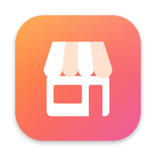

<p align="center"></p>

<h1 align="center">Vitrin</h1>

<p align="center">Mağaza sayfanız kodunuzdan oluşur, tüm <b>App Store Connect</b> işleriniz tek bir Mac uygulamasında toplanır.</p>

<p align="center">
  <a href="https://github.com/ardasnturk/vitrin/releases/latest"></a>
  <a href="https://github.com/ardasnturk/vitrin/actions/workflows/ci.yml"></a>
  
  <a href="LICENSE"></a>
</p>

<p align="center"><a href="https://vitrin.ardasnturk.com">Web sitesi</a> · <a href="README.md">English</a> · <b>Türkçe</b></p>

> Vitrin bağımsız, açık kaynaklı bir projedir. Apple Inc. ile bağlantısı yoktur; Apple tarafından onaylanmamış veya desteklenmemiştir. App Store, App Store Connect, iPhone, iPad ve diğer Apple markaları Apple Inc.'in ticari markalarıdır.

Vitrin, aynı hattı paylaşan bir uygulama ve bir Claude Code eklentisidir:

* **Mac için Vitrin** — ekibinizdeki tüm uygulamaları [asc CLI](https://github.com/rorkai/App-Store-Connect-CLI) üzerinden yöneten yerel bir uygulama: sürüm durumu, mağaza metinleri, ekran görüntüleri, derlemeler, TestFlight, incelemeler, fiyatlar ve analitik. Projeleriniz için mağaza sayfası hattını da on dilde çalıştırır.
* **`/vitrin` skill'i** — Claude Code içinde bir mobil uygulama projesini okur, rakipleri ve anahtar kelimeleri araştırır ve bir mağaza sayfasının ihtiyaç duyduğu her şeyi üretir: ASO uyumlu metadata, ekran görüntüleri, ürün sayfası ve App Preview görselleri. Yaratıcı kararları Claude verir; CLI ise toplar, üretir, doğrular ve yükler, hem de yalnızca sizin onayladığınızı.

Apple'ın Ekim 2026 itibarıyla geçerli kuralları ve doğrulanamayan noktalar [apple-notes.md](plugins/vitrin/skills/vitrin/references/apple-notes.md) dosyasında belgelenmiştir.

## Özellikler

- **Proje ve platform tespiti** — yerel Xcode, Flutter, React Native ve Expo projeleri (iOS tarafları için); uygulamanın yayınlandığı her Apple platformu (iPhone, iPad, iPhone Duo, Mac Catalyst dahil macOS, watchOS, tvOS, visionOS) kanıtlarıyla birlikte. Her çalıştırmada platformları bu listeden siz seçersiniz.
- **Proje analizi** — `.pbxproj`, `Info.plist`, entitlements, String Catalog'lar, asset catalog'lar, StoreKit yapılandırması, App Intents, `pubspec.yaml`, `app.json` ve kod sinyallerini okuyarak, kanıta dayalı özelliklerden oluşan bir uygulama profili çıkarır.
- **Rakip ve anahtar kelime araştırması** — iTunes Search/Lookup, RSS üst listeleri ve yorumlar (önbellekli, hız sınırlı), rakip ekran görüntülerinde macOS Vision OCR, k-means renk paletleri ve anahtar kelime puanlaması (alaka × popülerlik × rekabet); ayrıca uygulamanın her terimdeki kendi sırası ve canlı mağaza sayfasının bugün ne dediği. `vitrin write` alanları anahtar kelime planına göre denetler (seçilen terimler var mı, sıralanan terimler korunmuş mu, mağaza bölgesini paylaşan yereller birbirini tekrar etmiyor mu), `vitrin rank` ise sonucu sonradan ölçer. İsteğe bağlı Apple Ads ve AppTweak sağlayıcıları.
- **Metadata** — Claude'un yazdığı App Store alanlarını (ad, alt başlık, anahtar kelime alanı, açıklama, tanıtım metni, sürüm notları: grapheme ve UTF-8 bayt sayıları, tekrarlar, yasaklı terimler, rakip markalar, iddia-kanıt denetimleri) doğrular ve `metadata/store/metadata/` altına aktarır (mağaza metadata ağacı).
- **Ekranlar koddan, 1:1, derleme yok** — varsayılan olarak Claude, uygulamanın görünümlerini hangi dille yazılmış olurlarsa olsunlar (SwiftUI, UIKit, Flutter, React Native) okur; göstermeye değer her ekranı ölçülmüş boşluklar, uygulamanın renkleri ve yazı tipleri, gerçekçi demo verisi ve uygulamanın kendi arayüz metinleriyle HTML/CSS olarak yeniden kurar (`metadata/screens/`). Başlangıç noktası yerel bir arayüz kitidir (iOS, Material 3, watchOS, macOS). Vitrin bunları dil ve cihaz başına, tam ekran boyutunda, 9:41 durum çubuğuyla üretir. Xcode derlemesi, simülatör ya da demo modu gerekmez.
- **Hazır cihaz mockup'ları** — `vitrin mockups`, iPhone, iPad, iPhone Duo (kapalı, katlanma çizgisiyle açık ve ikisi birlikte), Apple Watch, Mac (dizüstü ve pencere), Apple TV ve Vision Pro için ekran dikdörtgenleriyle birlikte şeffaf şablonlar üretir ve uygulamanın üretilmiş ekranlarını bunların içine yerleştirir (`metadata/mockups/`). Ekran görüntüleri de aynı çerçeveleri kullanır.
- **Gerçek yakalama (isteğe bağlı)** — `capture.mode: launch-args`, uygulamayı platform başına derler (xcodebuild, `flutter build`, CocoaPods + xcodebuild, `expo prebuild`) ve ham ekranları özel simülatörlerde (9:41 durum çubuğu, yerel başına dil) veya Mac uygulama penceresinde yakalar.
- **Ekran görüntüleri** — Playwright ile üretilen HTML şablonları, kanıtlanmış bir App Store tasarım yöntemini izler: marka renklerinize göre tonlanan ve birleştirilebilen 16 stil ön ayarı (vurgu işlemleri, etiket kickerları, renk bloklu setler), fayda kontrol listeleri, marka lockup'ları ve geliştiricinin kendi fotoğrafları sahne olarak, karışık vurgulu başlık öncelikli yerleşimler, çeşitlendirilmiş cihaz çerçeveleme (taşan, eğik, iki cihaz, cihazsız), her aile için gerçekçi CSS cihaz çerçeveleri (iPhone, iPad, Duo, Mac, Watch, TV, Vision Pro), RTL, alfasız tam piksel boyutları. Claude yalnızca ön ayar seçmek yerine her uygulama için tasarım yapar: `<vitrin-device>` mockup'larıyla kareye özel sanat yönlendirmeleri (kendi paleti, yazı tipi ve cihaz işlemesi) ve kareye özel HTML yerleşimleri. `vitrin design --samples` dört tasarımı yan yana üretir, `store-preview.html` ise tam set hazırlanmadan önce cihazı (App Store iPhone/iPad), tasarımı ve açık/koyu görünümü açılır menülerle değiştirmenizi sağlar.
- **Kalite kapısı** — üretilen her görsel tarayıcıda ölçülür: cihaz yükseklik oranı, en büyük boş bant, en geniş başlık kelimesi, en kötü piksel başlık kontrastı, görsel katman sayısı ve küçük resim okunabilirlik testi.
- **App Preview'lar ve görseller** — dört stilde (`classic`, `showcase`, `kinetic`, `energetic`) Remotion kompozisyonları ve yedi sahne türü; bunların arasında dokunuşlar ve ekran geçişleriyle uygulamanın kullanımını gösteren `flow` da var. Hareket etmeyi sürdüren bir kamera, ekran görüntüleriyle aynı cihaz çerçeveleri, dikey iPhone/iPad ve yatay Mac/Apple TV önizlemeleri, ffmpeg ile H.264 High@4.0, 30 fps CFR, stereo AAC olarak normalleştirme; başlık ve arama döngüleri; In-App Event kartları.
- **Ürün Sayfası Optimizasyonu testleri** — `metadata/experiments.json`, ürün sayfası için bir A/B testi planlar (hipotez, her biri tek bir şeyi değiştiren en fazla üç varyant: başlık metni, ekran görüntüsü sırası veya alternatif simge; sayfa görüntülemeleri ve dönüşüme dayalı bir süre tahmini). `vitrin design` her varyantın ekran görüntüsü setini üretir, inceleme bunları gösterir ve `vitrin upload --experiment` testi her varyantın seti yerleştirilmiş bir taslak olarak oluşturur; sonuç, bir sonraki testi planlamak için geri yazılır.
- **Vitrin Studio** — `vitrin studio` tüm akışı `127.0.0.1` üzerinde yerel bir web arayüzünde açar (her değişiklik Studio'nun kendi sayfasının taşıdığı oturum belirtecini gerektirir ve `metadata/` altından gösterdiği HTML sanal alanda çalışır): her aşamanın durumunu, neyin onu engellediğini ve tek bir sonraki adımı gösteren bir akış; canlı günlükler; kurulum, HTML ekranları, metadata (App Store Connect sayaçları ve doğrulama satır içi), sanat yönlendirmesi, kare listesi (yanında üretilmiş set ve bir karenin tek tıkla yeniden üretimi) ve video planı için düzenleyiciler; tasarım örnekleri ve mağaza önizlemesi; onay ve reddin olduğu inceleme galerisi; ve anahtarlar (yalnızca adlar), deneme planı, açık onay, geri okuma ve sonlandırma ile yükleme. Bir Claude paneli kendi Claude Code'unuzu (`claude -p`, API anahtarı yok) herhangi bir brief üzerinde çalıştırır ve ne yaptığını gösterir; Claude bir karara ihtiyaç duyduğunda bir soru bırakır (`metadata/questions.json`), Studio bunu bir kart olarak gösterir ve siz yanıtlayınca Claude'a geri verir. Studio İngilizce veya Türkçe konuşur, CLI komutlarını ve ham JSON'u geliştirici moduna ayırır ve kendi başına asla yükleme, onaylama veya gönderme yapmaz.
- **Mac için Vitrin** — tüm akışı çalıştıran ve ekibin uygulamalarını asc CLI üzerinden App Store Connect'te yöneten yerel bir macOS uygulaması ([`apps/VitrinMac`](apps/VitrinMac)): sürüm durumu, mağaza metinleri, ekran görüntüleri, derlemeler, TestFlight, incelemeler, fiyatlar ve analitik; her asc komutu ait olduğu sekmede. Bir Apple Hesabı ile yeni uygulamalar ve Admin API anahtarları da oluşturur, Apple Ads'i bağlar. Sistem dilini izler, on dilde.
- **İnceleme ve onay** — `vitrin review --serve`, yüklenecek her şeyin yerel bir galerisini açar (her görsel, video ve metin; mağaza, platform, yerel ve hedef bazında, doğrulama sorunları satır içinde). Her şeyi onaylar ya da tek tek öğeleri yorumla reddedersiniz; onay her dosyanın bir karmasını kaydeder ve sonraki her değişiklik yeniden onay gerektirir.
- **Yükleme** — [asc CLI](https://github.com/rorkai/App-Store-Connect-CLI) (`brew install asc`) tek yükleyicidir: metinler için `asc metadata push`, görüntü türü başına `asc screenshots|video-previews upload --replace`, iPhone Duo ve görseller için App Asset Library, ayrıca Custom Product Page'ler ve In-App Event'ler. Anahtar `.env` dosyasından, Mac için Vitrin'den ya da asc'nin kendi `asc auth login` komutundan gelir. Kısmi çalıştırmalar ("yalnızca watchOS ekran görüntüleri", "yalnızca App Preview") seçmediğiniz hiçbir şeyi silmez veya ezmez. Her zaman önce bir deneme planı, açık onay ve yüklemeden sonra bir geri okuma. Görüntü türleri ve Asset Library adları Apple'ın App Store Connect API 4.5.1 OpenAPI belirtimini izler.
- **Tek klasör, düzenli depo** — Vitrin'in ürettiği her şey `metadata/` içinde durur (eski bir `.vitrin/` klasörü oraya otomatik taşınır); yönetilen bir `.gitignore` bloğu üretilen dosyaları git dışında tutarken Claude'un yazdığı kaynakların commit edilebilir kalmasını sağlar. Kontrol edilmiş bir yüklemeden sonra `vitrin finalize`, araştırma verilerini (`metadata/research/`) silip silmeyeceğinizi sorar ve başka hiçbir şeyi silmez.
- **Sizin dilinizde** — Vitrin varsayılan olarak İngilizce konuşur; skill önce sorar, ardından her soruyu, özeti ve inceleme galerisini seçtiğiniz dilde yazar (İngilizce ve Türkçe yerleşik, diğer diller Claude tarafından çevrilir).
- **Hızlı ilk çalıştırma** — önce tek dilde ve tek biçimde dört tasarım örneği gelir; bir tasarımı, mağaza dillerini ve biçimlerini seçtikten sonra geri kalanı yakalanıp üretilir.
- **Tekrar çalıştırılabilir, kaldığı yerden sürdürülebilir aşamalar** — `metadata/state.json` girdi karmalarını izler, böylece değişmeyen aşamalar atlanır.

## İçindekiler

* [Hızlı başlangıç](#hızlı-başlangıç)
* [Gereksinimler](#gereksinimler)
* [Kurulum](#kurulum)
* [Mac için Vitrin](#mac-için-vitrin)
* [Güncellemeler](#güncellemeler)
* [Komutlar](#komutlar)
* [Anahtarlar ve `.env`](#anahtarlar-ve-env)
* [Çıktı matrisi](#çıktı-matrisi)
* [Depo yapısı](#depo-yapısı)
* [Geliştirme](#geliştirme)
* [Örnek uygulama](#örnek-uygulama)
* [Katkıda bulunma](#katkıda-bulunma)
* [Lisans](#lisans)

## Hızlı başlangıç

Claude Code'u uygulamanızın deposunda açın ve şunu çalıştırın:

```
/vitrin
```

Skill önce hangi dilde konuşacağınızı sorar (varsayılan İngilizce). Yeni bir depoda `vitrin init` çalıştırır (yalnızca yapılandırma ve `.gitignore` bloğu; Vitrin'in ürettiği her şey `metadata/` içinde kalır). Hangi platformlar ve hangi içeriklerin üretileceğini sorar. Uygulamanın ekranlarını koddan HTML olarak yeniden kurar (derleme yok), cihaz mockup'larına yerleştirir, ardından tek dilde (uygulamada varsa İngilizce) dört örnek tasarım üretir; bunlardan en az biri uygulamanıza özel tasarlanmıştır. Mağazalar ve tasarımlar arasında geçiş yapabileceğiniz bir mağaza önizlemesi de gelir. Bir tasarımı onayladıktan sonra hangi mağaza dillerinin ve biçimlerin üretileceğini sorar. Her aşamada sizi yürütür, yaratıcı girdileri kendisi yazar, her şeyi inceleme galerisinde size gösterir, anahtarlarınızı yalnızca yükleme sırasında ister ve açık bir "evet" olmadan asla yüklemez veya göndermez. `/vitrin` başka bir komutla çakışıyorsa `/vitrin:vitrin` kullanın.

## Gereksinimler

- macOS (Vision OCR; simülatörler ve Mac pencere yakalama yalnızca `capture.mode: launch-args` için)
- Node.js ≥ 22 (pnpm yalnızca geliştirme için)
- Xcode (`simctl` ile) yalnızca gerçek yakalamalar için (`capture.mode: launch-args`); HTML ekranlar Xcode gerektirmez
- App Store yüklemeleri için: asc CLI (`brew install asc`)
- ffmpeg / ffprobe
- Çapraz platform uygulamaları için, gerektiğinde: Flutter SDK veya React Native ve Expo için Node/CocoaPods
- `/vitrin` skill'i için [Claude Code](https://claude.com/claude-code)

## iPhone'da

Mac'te [Remote Code](https://github.com/ardasnturk/remote-code) 1.6.0 ile Vitrin, iPhone'unuzda bir sekme olur: dosya tarayıcısıyla uygulama klasörlerinizi ekleyin, tüm akışı yerel ekranlarda yürütün ve App Store Connect'i yönetin. Remote Code gerekenleri `vitrin hub` ile ([API](docs/HUB_API.md)) kendisi başlatır, yani Vitrin for Mac'in açık olması gerekmez.

## Kurulum

**Mac uygulaması** — noter onaylı `Vitrin-<version>.dmg` dosyasını [GitHub Releases](https://github.com/ardasnturk/vitrin/releases/latest) sayfasından indirin ya da Homebrew kullanın:

```sh
brew tap ardasnturk/vitrin https://github.com/ardasnturk/vitrin
brew install --cask vitrin
```

Vitrin'i açın ve karşılama turunu izleyin. Mac'inizdeki araçları kontrol eder ve eksik olanları tek tıkla kurar: asc CLI ve mağaza sayfası hattı için Vitrin CLI.

**Claude Code eklentisi** — Claude Code içinde bir kez kurun:

```text
/plugin marketplace add ardasnturk/vitrin
/plugin install vitrin@vitrin
```

ya da bir terminalden: `claude plugin install vitrin --marketplace ardasnturk/vitrin` (Claude Code 2.1.292 veya daha yenisi; eski sürümler: `claude plugin marketplace add ardasnturk/vitrin && claude plugin install vitrin@vitrin`).

Eklenti, `/vitrin` skill'ini ve Claude için bir `vitrin` komutu ekler. Node.js 22+ dışında baştan başka bir şey gerekmez: skill `vitrin` komutunu ilk çalıştırdığında eklentinin sürümüne ait sürüm arşivini indirir, eklentide kayıtlı sağlama toplamıyla karşılaştırır (`plugins/vitrin/SHA256SUMS`; farklıysa hiçbir şey kurulmaz) ve CLI'yı Playwright Chromium dahil `~/.local/share/vitrin/<version>/` altına kurar (`VITRIN_HOME` ile değiştirilebilir). Bu tek seferlik adım yaklaşık 450 MB indirir ve birkaç dakika sürer; sudo gerektirmez ve global npm paketi kurmaz. `claude plugin update vitrin@vitrin` ile güncelleyin (ya da `/plugin` → Marketplaces → Update); yeni sürüm CLI'sını bir sonraki çalıştırmada kurar.

CLI'yı kendi terminalinizde de kullanmak için: `npm install -g https://github.com/ardasnturk/vitrin/releases/download/v2.3.0/ardasnturk-vitrin-2.3.0.tgz`.

Skill tek başına [skills CLI](https://github.com/vercel-labs/skills) ile de eklenebilir (`npx skills add ardasnturk/vitrin`), ancak o zaman `vitrin` komutu eksik kalır; eklentiyi tercih edin.

**Katkıda bulunanlar** bir klonla çalışırken `plugins/vitrin/skills/vitrin/scripts/install.sh` dosyasını yine çalıştırabilir: bu depoyu derler, npm'in global bin klasörüne bir `vitrin` başlatıcısı yazar (`VITRIN_BIN_DIR` ile değiştirilebilir) ve skill'i `~/.claude/skills/vitrin` altına kopyalar (`CLAUDE_SKILLS_DIR` ile değiştirilebilir). Eklenti kuruluyken `VITRIN_DEV=/path/to/vitrin` ayarı, eklentinin `vitrin` komutunun yerel derlemenizi çalıştırmasını sağlar.

## Mac için Vitrin

App Store Connect bağlantısı isteğe bağlıdır; bir kez girilen bir API anahtarıyla ya da asc'nin kendi girişiyle yapılır. Sonrasında:

* **Ekibinizdeki her uygulama** — kenar çubuğunda simgeler, sürümler ve durumlar, bir uygulamanın her bölümü için ayrı bir sekme; kullanıcılar, cihazlar, imzalama, raporlar, otomasyon, Apple Ads ve hesap için ekip sayfaları.
* **Komutlar özelliğe dönüşür** — asc'nin 1.300 komutu ait oldukları sekmede durur. Yalnızca okuyanlar kendiliğinden yüklenir ve JSON değil, liste ve kart olarak gösterilir; bir şeyi değiştirenler kısa bir formu olan bir düğmedir. Dil kodları, kategoriler ve durumlar kelime olarak okunur.
* **Masanızdan yayın** — bir sürümün neden gönderilemediği, App Review'un ne gördüğü, gönderim geçmişi; ardından gönderme, yayınlama ya da aşamalı yayınlama.
* **Uygulama ve anahtar oluşturma** — Apple'ın API'si uygulama oluşturamaz, bu yüzden Apple Hesabınızla oturum açılır; aynı oturum tek adımda bir Admin API anahtarı üretir ve App Store Connect analitik panolarını gösterir. Parola, asc ile birlikte anahtar zincirinde kalır.
* **Apple Ads** — uygulamanın içinde bağlanır: Vitrin anahtar çiftini üretir ve oturum açar; Apple sizden bir kez üç kısa adım ister.
* **Projeleriniz** — bir depo ekleyin ve tüm `/vitrin` akışını yanında Claude ile bir pencerede çalıştırın.
* **Menü çubuğu** — hangi uygulamaların reddedildiği ya da incelemede olduğu, neyin çalıştığı ve beklediği.
* **Sizin dilinizde** — sistemi İngilizce, Almanca, İspanyolca, Fransızca, İtalyanca, Japonca, Korece, Brezilya Portekizcesi, Türkçe ve Basitleştirilmiş Çince olarak izler. Her bölüm bir bilgi düğmesiyle kendini açıklar.

Daha fazlası [apps/VitrinMac](apps/VitrinMac) içinde.

## Güncellemeler

Mac uygulaması GitHub'da yeni sürümü günde bir kez kontrol eder (Settings → Updates) ve varsa sürüm sayfasını açar. Homebrew kullanıcıları `brew upgrade --cask vitrin` çalıştırabilir. Claude Code eklentisi `claude plugin update vitrin@vitrin` ile güncellenir.

## Komutlar

| Komut | Çıktı |
| --- | --- |
| `vitrin init [--language tr]` | `vitrin.config.yaml` ve yönetilen `.gitignore` bloğu; `.env.example` yalnızca yükleme kapısında |
| `vitrin doctor [--tools]` | Araçlar, `.env`, `.p8`, canlı JWT testi, uygulama kaydı, düzenlenebilir sürüm, URL'ler, Asset Library refData |
| `vitrin analyze` | `metadata/app_profile.json` — proje türü, platformlar, hedefler, yereller, entitlements, izinler, IAP, App Intents, renkler, kanıta dayalı özellikler |
| `vitrin platforms [--json]` | Kanıtlarıyla tespit edilen platformlar ve her birinin üreteceği hedefler |
| `vitrin select --platforms … --assets … --targets … --locales … --primary-locale … --language … --uploader … --capture … --support-url … --privacy-url … --marketing-url …` | Kullanıcının seçimlerini `vitrin.config.yaml` içinde saklar: platformlar, içerik türleri (`metadata`, `screenshots`, `previews`, `creatives`, `events`), biçimler (hedef kimlikleri), mağaza yerelleri ve birincil yerel, konuşma dili, App Store yükleyicisi ve sayfa URL'leri (http(s); `""` birini kaldırır) |
| `vitrin uploader [--json]` | asc CLI'nın kurulu ve oturum açık olup olmadığı |
| `vitrin asc apps [--json]` | Ekibin App Store Connect'teki uygulamaları; platform başına en yeni App Store sürümü ve durumu ile; ortamda `ASC_KEY_ID`, `ASC_ISSUER_ID` ve `ASC_KEY_PATH` varsa her klasörde çalışır (bir projenin içindeyse kalanını `.env` doldurur) |
| `vitrin research` | `metadata/research/competitors.json`, `metadata/research/keywords/<locale>.json` (terim başına uygulamanın kendi sırasıyla), `live-listing.json` (mağazanın bugün gösterdiği) — iTunes Search/Lookup, RSS, yorumlar, OCR, paletler, rekabet/popülerlik, anahtar tanımlıysa App Store Connect |
| `vitrin write` | Claude'un metadata'sını kurallara ve anahtar kelime planına göre doğrular → `metadata/store/metadata/` ve bitmiş metin, okunabilir biçimde, `metadata/app-store/<platform>/<locale>/*.txt` içinde |
| `vitrin rank` | Uygulamanın seçilen ve en yüksek puanlı terimlerdeki kendi arama sırası → `metadata/rankings/<date>.json`, önceki anlık görüntüyle karşılaştırılır (değişiklikten önce ve 1–2 hafta sonra çalıştırın) |
| `vitrin capture` | Ham ekranlar → `metadata/raw/<locale>/<family>/`: `metadata/screens/` altındaki Claude'un HTML ekranları (varsayılan, derleme yok) veya simülatörler ve Mac penceresi (`capture.mode: launch-args`) |
| `vitrin mockups [--screens] [--only …] [--list]` | Cihaz mockup şablonları (şeffaf PNG + `mockups.json` ekran dikdörtgenleri) → `metadata/mockups/templates/`; `--screens` üretilmiş ekranları bunların içine yerleştirir → `metadata/mockups/screens/` |
| `vitrin design --samples [--styles …] [--locale …]` | İlk üç kare dört tasarımda (ön ayarlar ve/veya `art-direction.json` içindeki özel seçenekler), tek dilde, etiketli bir kontakt sayfası ve cihaz, tasarım ve görünüm menüleri olan `store-preview.html` (App Store iPhone, etkinse iPad) → `metadata/design-samples/` (yalnızca karşılaştırma için) |
| `vitrin design` | HTML → Playwright → `metadata/store/screenshots/<locale>/NN_<slug>_<target>.png`, `metadata/creative/`, kalite kapısı |
| `vitrin video [--styles all] [--studio]` | Remotion → `metadata/store/app-previews/<locale>/…mp4`, başlık/arama döngüleri; `--studio` ilk önizlemeyi Remotion Studio'da açar (geliştirme klonu) |
| `vitrin validate` | `metadata/validation.json` (hata varsa çıkış kodu 1) |
| `vitrin review [--serve] [--print-labels]` | `metadata/report.html`, yüklenecek her şeyin galerisi, `ui.language` dilinde; `--serve`, `127.0.0.1` üzerinde onay ve ret düğmeleri ekler; `--print-labels`, `metadata/i18n/<language>.json` içine çevrilecek kelimeleri yazdırır |
| `vitrin studio [--port 4871] [--no-open]` | `127.0.0.1` üzerinde Vitrin Studio: aşamalar, düzenleyiciler, önizlemeler, inceleme galerisi, onay, yükleme ve tarayıcıda bir Claude paneli (Ctrl+C'ye kadar çalışır) |
| `vitrin approve [--expect-hash …] [--reject … --comment …]` | Kullanıcının onayını (veya retlerini) `metadata/approval.json` içine kaydeder; son doğrulamada hata varken reddeder |
| `vitrin upload [--dry-run] [--creatives] [--cpp] [--events] [--experiment [id]]` | Değiştirilecek ve dokunulmayacak setleri gösteren plan; onaydan sonra: görüntü türü başına asc ve metin (Duo ve görseller için Asset Library) / CPP / In-App Event'ler / bir Ürün Sayfası Optimizasyonu testi (taslak), ardından geri okuma |
| `vitrin finalize --checked --delete-research \| --keep-research` | Kontrol edilmiş bir yüklemeden sonra: neyin yüklendiğini kaydeder (`metadata/uploaded.json`) ve araştırma verilerini yalnızca kullanıcı isterse siler |
| `vitrin submit --confirm <bundleId>` | İncelemeye gönderir (yalnızca açık onayla) |
| `vitrin all` | Her aşamayı sırayla çalıştırır; girdi veya onay gereken aşamada durur |

Global seçenekler: `-C, --cwd <dir>`, `-f, --force`, `--json`, `-q, --quiet`. Komuta özgü bayraklar için `vitrin <command> --help` çalıştırın.

### Çıkış kodları

| Kod | Anlamı |
| --- | --- |
| `0` | Tamamlandı |
| `1` | Hata veya doğrulama başarısızlığı |
| `2` | Girdi bekleniyor — `metadata/briefs/<stage>.md` içinde Claude için bir brief veya kullanıcı için eksik anahtarlar |

Aşamalar `metadata/state.json` sayesinde tekrar çalıştırılabilirdir; `--force` bir aşamayı yeniden çalıştırır.

## Anahtarlar ve `.env`

`.env` (asla commit edilmez):

```
ASC_KEY_ID=          # ASC > Users and Access > Integrations > App Store Connect API (Team Key, ≥ App Manager)
ASC_ISSUER_ID=
ASC_KEY_PATH=./secrets/AuthKey_XXXXXXXXXX.p8   # or ASC_KEY_CONTENT_BASE64
```

İsteğe bağlı: Apple Ads, AppTweak, `REVIEW_DEMO_USER/PASSWORD`, `VITRIN_CHROMIUM` (sabitlenmiş Playwright tarayıcısı eksik olduğunda bir Chromium yolu). Anahtarlar eksikken analiz ve üretim devam eder; `doctor` geçene kadar yükleme başlamaz ("erken uyar, geç engelle"). Gizli değerler tüm günlüklerde maskelenir.

## Çıktı matrisi

| Görsel | Boyut (px) |
| --- | --- |
| iPhone 6.3" (zorunlu) / 6.9" | 1206×2622 / 1320×2868 |
| iPad 13" (uygulama iPad'i destekliyorsa) | 2064×2752 |
| iPhone Duo dış / iç | 1398×2034 / 2007×2853 |
| Mac (16:10) | 2880×1800 |
| Apple Watch Ultra / Series | 422×514 / 416×496 |
| Apple TV 4K · Apple Vision Pro | 3840×2160 |
| App Preview iPhone (30 fps, H.264 High@4.0, stereo AAC) · Mac / Apple TV · Vision Pro | 886×1920 · 1920×1080 · 3840×2160 |
| Ürün sayfası başlığı (21:9) · Arama sonucu (3:2) | 3840×1646 · 1920×1280 – 3840×2560 |

Yalnızca seçtiğiniz platformların hedefleri üretilir. Tam liste, kaynaklar ve hâlâ doğrulanmamış olanlar: [data/targets.json](data/targets.json) ve [apple-notes.md](plugins/vitrin/skills/vitrin/references/apple-notes.md).

## Depo yapısı

```
packages/cli        commands, state, briefs, HTML screens, build + capture (simulators, Mac), review gallery, approval, finalize,
                    studio/ (the Studio server: jobs, editable files, overview, the Claude runner)
packages/studio     the Studio UI (React, built with esbuild into dist/ by `pnpm build`; shipped prebuilt as studio/ in the npm package)
packages/schemas    zod schemas (AppProfile, Competitors, KeywordPlan, Metadata, ArtDirection, ShotList, VideoPlan, Approval, Config)
packages/core       masking logger, exec, state, config/.env, data files, cached HTTP, enabled targets, .gitignore block
packages/analyzer   project kind and platform detection; pbxproj / plists / entitlements / catalogs / StoreKit / Flutter / React Native / code signals
packages/research   iTunes Search/Lookup, RSS, reviews, Vision OCR (Swift), k-means palette, keyword scoring
packages/validate   text, image quality, video and claim-to-evidence checks
packages/render     HTML templates, style presets, device frames, quality measurement, design samples; Playwright + sharp
packages/video      Remotion: AppPreview (portrait and landscape), HeaderLoop, SearchLoop, EventCard; ffmpeg normalization
packages/upload     asc CLI, ASC API (JWT), App Asset Library, CPP, In-App Events, partial-upload plan and read-back
data/               targets.json, asc-display-types.json, asc-locales.json, storefront-languages.json, forbidden-terms.json
plugins/vitrin/     Claude Code plugin: .claude-plugin/plugin.json, bin/vitrin (self-installing launcher),
                    skills/vitrin/ (SKILL.md, references/ incl. apple-notes.md and styles/, scripts/install.sh)
.claude-plugin/     marketplace.json (this repository is the `vitrin` plugin marketplace)
scripts/            pack.mjs (`pnpm pack:release` → @ardasnturk/vitrin tarball), release-notes.mjs, site-assets.mjs, site-icons.mjs
docs/               design/master-prompt.md (original design spec)
examples/Ritim      SwiftUI sample app (tr + en) with the full output of a /vitrin run
```

## Geliştirme

```bash
pnpm install
pnpm build
pnpm test
node packages/cli/dist/bin.js --cwd examples/Ritim validate
node packages/cli/dist/bin.js --cwd examples/Ritim studio   # the Studio on the example; `pnpm dev:studio` rebuilds the UI on change
```

Sürümler: `package.json` içindeki `version` değerini (tek kaynak), `plugins/vitrin/.claude-plugin/plugin.json`, `.claude-plugin/marketplace.json` içindeki `vitrin` girdisini ve her `packages/*/package.json` dosyasını aynı değere yükseltin (bir test bunu denetler), CHANGELOG bölümünü ekleyin, `pnpm release:checksum` çalıştırın (derler, paketler ve arşivin sağlama toplamını `plugins/vitrin/SHA256SUMS` içine kaydeder), commit edin; ardından Mac uygulamasının DMG'sini derleyin ve `v<version>` etiketini gönderin ([apps/VitrinMac/docs/RELEASE.md](apps/VitrinMac/docs/RELEASE.md)). Sürüm iş akışı testleri çalıştırır, `pnpm pack:release` komutunu çalıştırır, arşivi kayıtlı sağlama toplamıyla uyuşmuyorsa yayınlamayı reddeder ve `ardasnturk-vitrin-<version>.tgz` ile `SHA256SUMS` içeren GitHub Release'i oluşturur; eklentinin başlatıcısı da indirileni kurmadan önce kayıtlı sağlama toplamıyla doğrular. `NPM_TOKEN` secret'ı tanımlıysa npm'e de yayınlar. Sağlama toplamı, gunzip edilmiş tar'ın SHA-256 değeridir (`gunzip -c … | shasum -a 256`); etiketli commit'i derleyen her makinede aynıdır, gzip katmanı ise Node sürümleri arasında farklılık gösterir.

## Örnek uygulama

[`examples/Ritim`](examples/Ritim), küçük bir SwiftUI alışkanlık takipçisidir (Türkçe ve İngilizce) ve depo, bir `/vitrin` çalıştırmasının onun için ürettiği her şeyi barındırır: SwiftUI görünümlerinden HTML olarak yeniden kurulmuş ekranlar, anahtar kelime araştırması ve mağaza metinleri, mağaza önizlemesiyle dört tasarım örneği, iPhone ve iPad ekran görüntüleri, App Preview'lar, görseller, bir In-App Event ve inceleme galerisi — bkz. [README](examples/Ritim/README.md#what-vitrin-produced). Ayrıca gerçek simülatör yakalamaları için bir `-VitrinDemo` başlatma argümanı demo modu içerir (`examples/Ritim/Ritim/Support/VitrinDemo.swift`); bunu kendi uygulamanıza kopyalarsanız ekran görüntüleri kararlı, kişisel olmayan verileri gösterir.

## Katkıda bulunma

Katkılar memnuniyetle karşılanır — [CONTRIBUTING.md](CONTRIBUTING.md) ve [Davranış Kuralları](CODE_OF_CONDUCT.md) dosyalarına bakın. Bir güvenlik sorununu bildirmek için herkese açık bir issue açmak yerine [SECURITY.md](SECURITY.md) dosyasını izleyin.

## Lisans

[MIT](LICENSE)

### Bağımlılıkların lisansları

- Yazı tipleri SIL Open Font License (OFL) ile lisanslıdır ve [@fontsource](https://fontsource.org) üzerinden paketlenir.
- Simgeler [Lucide](https://lucide.dev) kaynaklıdır (ISC).
- Ekran görüntüsü tasarım yöntemi ve `plugins/vitrin/skills/vitrin/references/styles/` içindeki stil ön ayarlarından on ikisi [ParthJadhav/app-store-screenshots](https://github.com/ParthJadhav/app-store-screenshots) projesinden uyarlanmıştır (MIT, © 2026 Parth Jadhav); diğer dördü Vitrin'e aittir.
- [Remotion](https://www.remotion.dev) bireyler ve en fazla 3 çalışanı olan şirketler için ücretsizdir; daha büyük ekipler bir [Remotion şirket lisansı](https://github.com/remotion-dev/remotion/blob/main/LICENSE.md) almalıdır.
