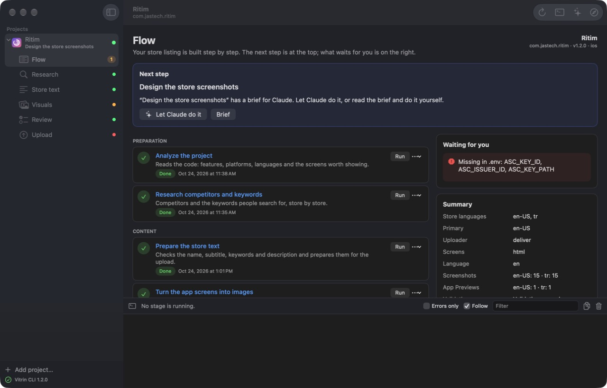
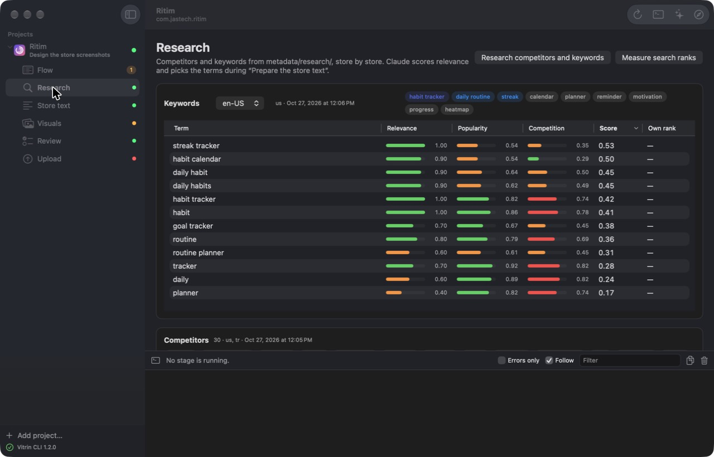
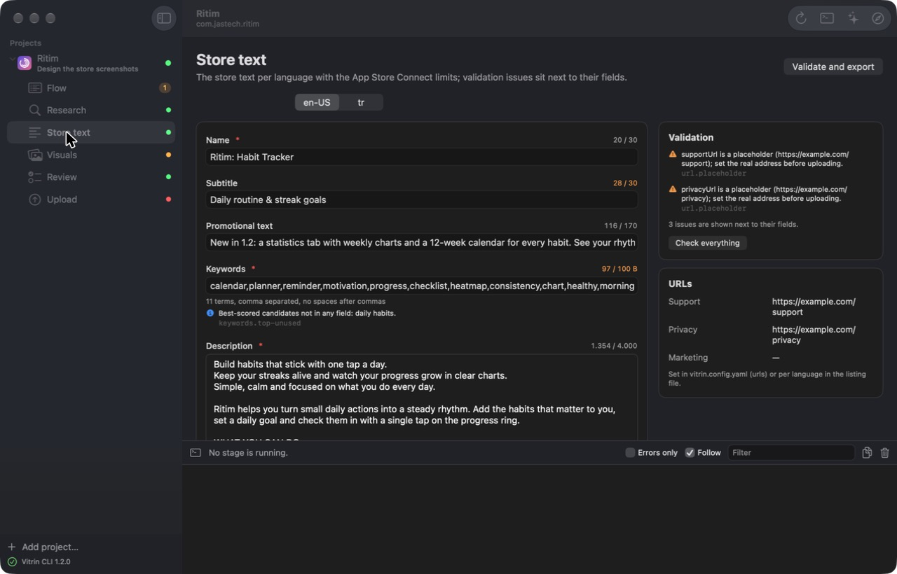
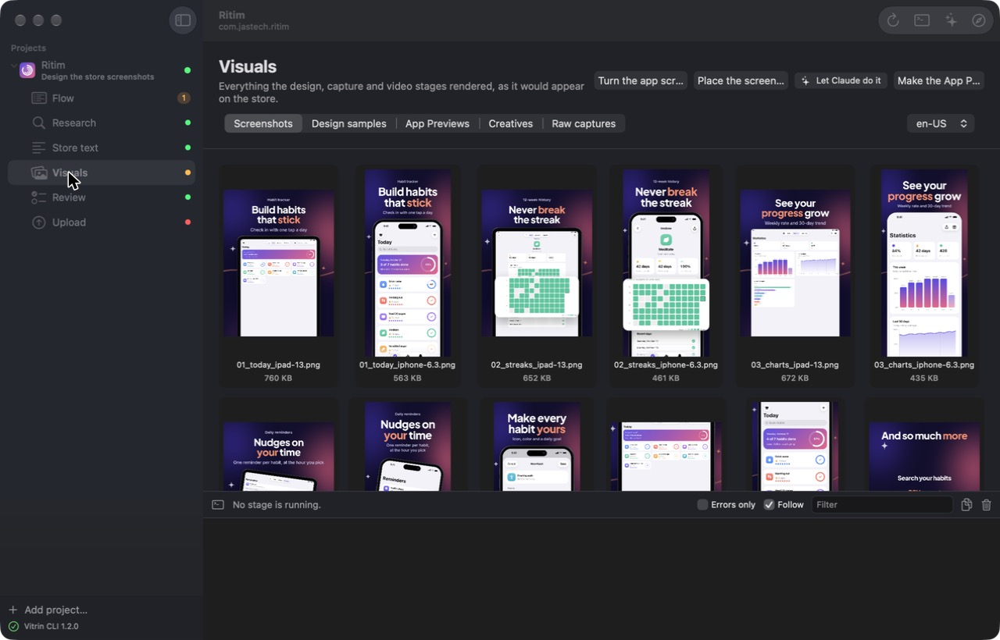
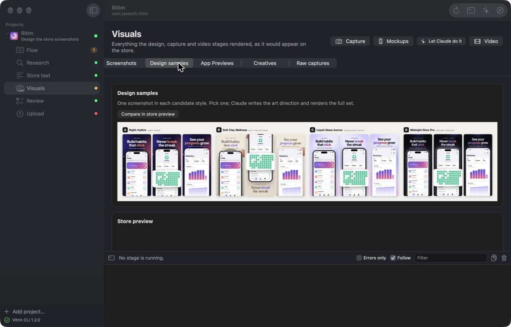
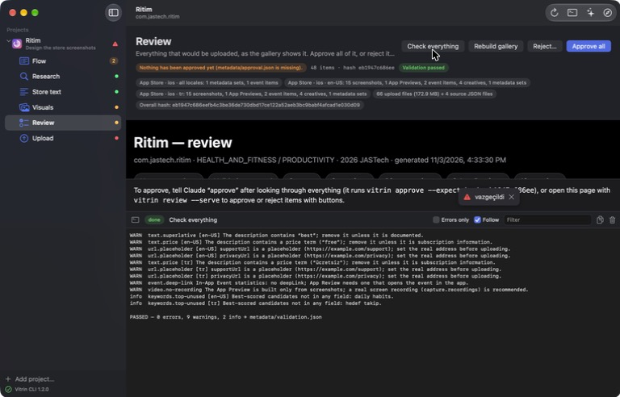
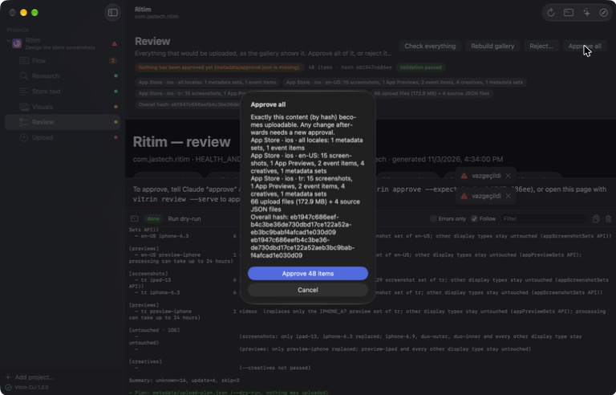
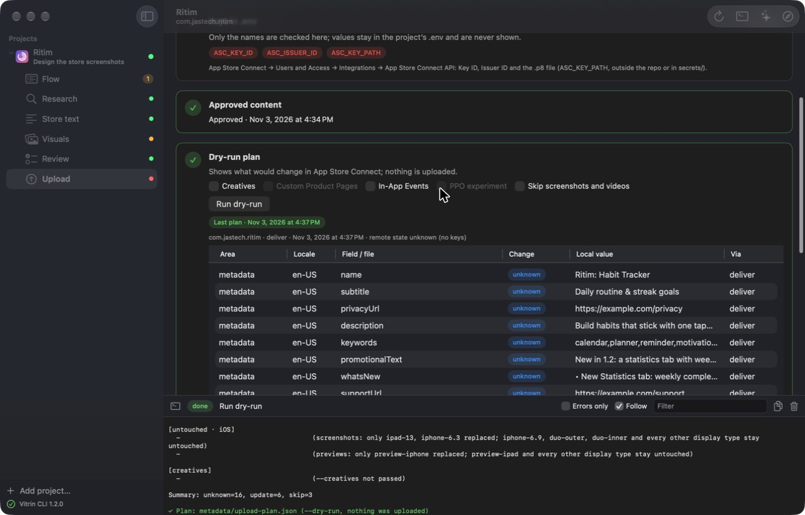
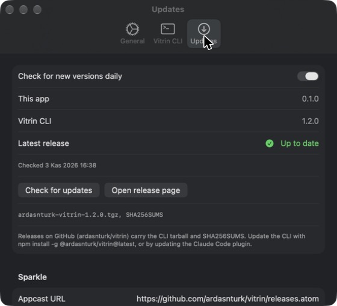
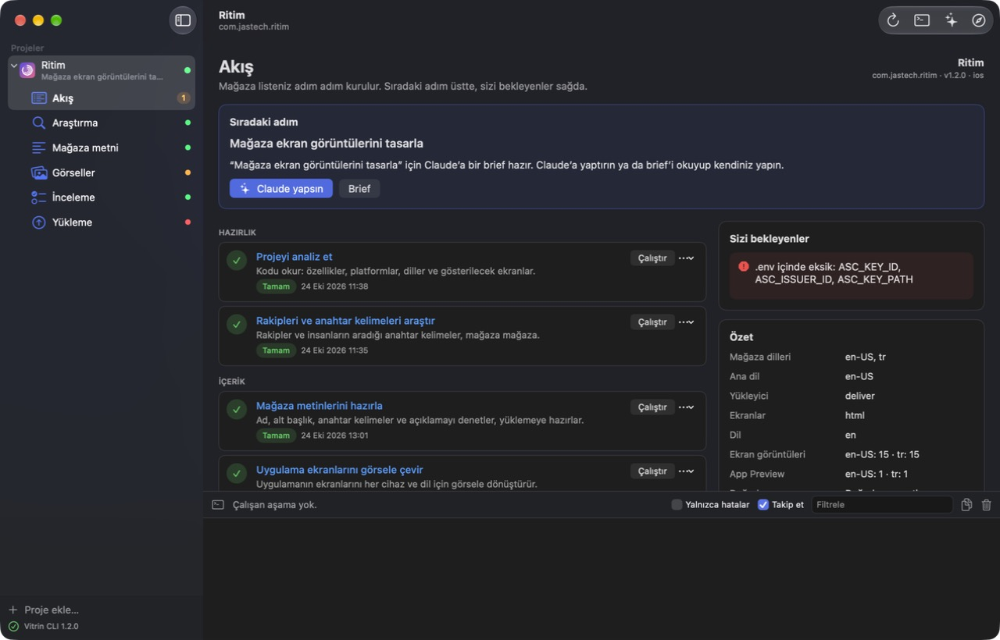

# Vitrin for Mac

A native macOS app over the Vitrin pipeline: add a mobile app's repository, run the stages, watch the log, answer
Claude's questions, edit the store text, look at the screenshots and App Previews, review and approve, and upload to
App Store Connect, all from one window. It keeps running in the menu bar and checks GitHub for new releases.

It also manages App Store Connect, through the [asc CLI](https://github.com/rorkai/App-Store-Connect-CLI). Connecting is
optional, either with a key entered once (Settings → Account) or with asc's own login. Then the sidebar lists the
team's apps with their icons, and each app has tabs for its status, store text, screenshots, builds, TestFlight,
reviews, purchases, analytics and the rest; team pages cover users, devices, signing, reports, automation, Apple Ads
and the account. What only reads loads by itself and shows in words, what changes something is a button with a short
form, and every asc command sits behind "More in App Store Connect" on the tab it belongs to
(`VitrinMac/Resources/asc-commands.json`, refreshed by `scripts/asc-catalog.py`; `docs/asc-komutlari.md` lists what
could not be run on a real account).

Apple's API can't create an app, so that goes through an Apple Account sign-in (`asc web`), which also makes an Admin
API key in one step and shows the App Store Connect analytics dashboards. The password stays with asc in the keychain.

The app follows the system language, in English, German, Spanish, French, Italian, Japanese, Korean, Brazilian
Portuguese, Turkish and Simplified Chinese, falling back to English.



## Requirements

- macOS 15 or newer, Xcode 16 or newer (built with Xcode 27.1, Swift 6, strict concurrency).
- [XcodeGen](https://github.com/yonaslab/XcodeGen) to regenerate the project (`brew install xcodegen`).
- The Vitrin CLI, Vitrin **2.0 or newer** (`vitrin studio --token-file`), and Node.js 22+ to run it. The app looks for it in this order:
  1. the path set in Settings → Vitrin CLI (a `bin.js` or a `vitrin` executable),
  2. the Claude Code plugin install (`${VITRIN_HOME:-~/.local/share/vitrin}/<version>/node_modules/@ardasnturk/vitrin/dist/bin.js`, newest version),
  3. `vitrin` on the login shell's PATH (`npm install -g @ardasnturk/vitrin`),
  4. a developer checkout (Settings → Vitrin checkout, or `VITRIN_DEV`): `packages/cli/dist/bin.js` after `pnpm build`.

  A candidate counts only when its `studio --help` knows `--token-file`; older installs are skipped and named in the error.
- Optional, as for the CLI: `claude` for the creative stages, `ffmpeg` for videos, `asc` for App Store Connect and the upload (Homebrew installs it from the app), fastlane only for Google Play.

## Build

```bash
cd apps/VitrinMac
xcodegen generate
xcodebuild -scheme VitrinMac -destination 'platform=macOS' build
```

The project signs ad hoc (`CODE_SIGN_IDENTITY: "-"`) with the Hardened Runtime on and the App Sandbox off (the app
starts Node.js in the user's project folders). Set your team in `project.yml` to run it signed; notarization and a
signed Sparkle feed are not set up (see Updates).

To try it with the example: `pnpm build` in the repository, open the app, Settings → Vitrin CLI → Vitrin checkout =
the repository path, then Add project… → `examples/Ritim`.
Without the dialog: `open -a Vitrin --args --project /path/to/examples/Ritim` adds and opens that folder at launch.

## Architecture

The app writes no pipeline logic of its own. Per project it starts the Studio backend,

```
vitrin --cwd <project> studio --no-open --port 0 --token-file <tmp>/studio-<uuid>.json
```

reads the handshake the CLI writes (`url`, `port`, `token`, `pid`, `version`; file mode 0600, written atomically) and
talks to the Studio's HTTP API on 127.0.0.1 with the session token in `x-vitrin-token`. `SIGTERM` to the CLI stops the
server and removes the file; the app sends it when a project is closed, when it quits, and on `SIGTERM`/`SIGINT`.

| Layer | Files | What it does |
| --- | --- | --- |
| CLI | `Core/CLILocator.swift`, `Core/CLIRunner.swift` | Finds Node.js 22+ and the CLI through the login shell's PATH; runs `vitrin <cmd> --json` (exit 0 ok, 1 failed, 2 needs input) for `doctor --tools`, `uploader` and `asc apps`. |
| Apps | `Core/ASCApps.swift`, `Views/AppOverviewView.swift` | The team's apps from App Store Connect (`vitrin asc apps --json` with the account key, outside any project), refreshed at launch, after the key changes and on demand; the bundle id of each local project's `vitrin.config.yaml` links a row to its project. |
| Studio | `Core/StudioProcess.swift`, `Core/StudioClient.swift`, `Core/StudioEvents.swift` | The process and its handshake; the API client (`/api/overview`, `/api/jobs`, `/api/file`, `/api/claude`, `/api/questions/answer`, `/api/review`, `/api/approve`, `/api/reject`, `/files/…`); the SSE stream (`log`, `job`, `claude`, `changed`, `remotion`), parsed byte by byte. |
| State | `Core/ProjectSession.swift`, `Core/ProjectStore.swift`, `App/AppModel.swift`, `Core/AppSettings.swift` | One `@Observable` session per open project (overview, running job, log lines, Claude runs, toasts); the persistent project list (`~/Library/Application Support/Vitrin/projects.json`); the root model; preferences. |
| Models | `Core/Models.swift`, `Core/JSONValue.swift`, `Core/Limits.swift` | The Studio's JSON by hand, statuses kept as strings so a newer server never breaks decoding; the App Store Connect text limits. |
| UI | `Views/*` | `NavigationSplitView`: projects and their pages in the sidebar, the page as detail, the live log under it (draggable), Claude in a side column (a plain `HStack`: SwiftUI's `.inspector` raised an NSException inside AppKit layout on macOS 15 and 26 the first time the column opened). |
| Menu bar | `Views/MenuBarView.swift`, `App/AppDelegate.swift` | `MenuBarExtra` with the running or last stage, pending decisions per project and quick actions; the window can close while the app keeps running. |
| Updates | `Core/UpdateChecker.swift` | GitHub Releases (`ardasnturk/vitrin`, latest tag, assets incl. `SHA256SUMS`) against the CLI and app versions, daily when enabled, with a notification. `SparkleUpdater` is a skeleton with the appcast URL setting. |
| Words | `Core/Localization.swift`, `Resources/Localizable.xcstrings` | English and Turkish; "Follow the project" uses `ui.language` from `vitrin.config.yaml`, like the Studio, and switches at runtime. |

### Pages

- **Apps** (the sidebar's first section): every app on the team with its bundle id, the newest App Store version and its state; a link badge when a local project has that bundle id. Selecting an unlinked app shows `AppOverviewView`: platforms, the newest version and state per platform, SKU, primary language, the App Store Connect id, *Open in App Store Connect*, and *Link a project folder*, which is the same folder picker as *Add project…*. Without a key the section says where to enter one; a refresh button sits in the section header and in the toolbar.
- **Flow**: the next step first (Claude's question, a blocker with its one-click fixes, a brief for Claude, the approve or upload click, or the stage to run), then the stages in Preparation / Content / Check and publish with the status the server computed, and what waits for you.
- **Research**: the keyword candidates per language (relevance, popularity, competition, score, own rank; sortable) and the competitors with the terms Claude found in their names.
- **Store text**: name, subtitle, promotional text, keywords (UTF-8 bytes), description and What's New with the App Store Connect counters; validation issues next to their fields; saved through the Studio, which validates against the schema.
- **Visuals**: the rendered screenshots per language, the design samples with the contact sheet and the store preview (`store-preview.html` in a `WKWebView`), the App Previews (`AVPlayer`), creatives, raw captures and device mockups.
- **Review**: the gallery (`report.html`, sandboxed) with the summary, the overall hash, *Approve all* behind a confirmation, and *Reject…* with a comment per item for Claude.
- **Account** (Settings → Account): the App Store Connect API key, once for every project. The .p8 is copied to `~/Library/Application Support/Vitrin/keys/` with owner-only permissions, the ids next to it in `credentials.json`; each Studio the app starts gets them as `ASC_KEY_ID`, `ASC_ISSUER_ID` and `ASC_KEY_PATH`. A project whose own `.env` sets `ASC_KEY_ID` keeps its key (the CLI reads the environment first, then `.env`, so the app stays out of the way). Saving or removing the key restarts the open Studios.
- **Claude model** (Settings → General, or the menu in the Claude column's header): the model the briefs run with, sent as `model` with every `/api/claude` call and passed to Claude Code as `--model`. Empty = Claude Code's default (the Studio then falls back to `ui.claudeModel` in `vitrin.config.yaml`). Each run's row shows the model Claude Code reported.
- **Upload**: asc CLI → keys by name only, values never leave `.env` → approved content → dry-run plan (`upload-plan.json` as a table, the log behind a disclosure) → *Upload now*, which asks you to type the app name and still passes the CLI's approval hash gate; then read-back, finalize (keep or delete the research data) and submit (type the bundle id).

The gallery's own approve and reject buttons are inert inside the app (they post to a parent page that is not there); the app's buttons record the decision with the session token.

## Screenshots

| | |
| --- | --- |
|  |  |
|  |  |
|  |  |
|  |  |
|  | |

## Tests

Two bundles, both in the `VitrinMac` scheme (`xcodegen generate` first; always build into `build-test`, never into the
`build` folder a running Xcode build may use):

```bash
cd apps/VitrinMac
xcodebuild test -scheme VitrinMac -destination 'platform=macOS' -derivedDataPath build-test -only-testing:VitrinMacTests
xcodebuild test -scheme VitrinMac -destination 'platform=macOS' -derivedDataPath build-test -only-testing:VitrinMacUITests
```

- **VitrinMacTests** (unit tests, hosted in the app): `UpdateChecker.compare`, `JSONValue` round trips, the SSE parser
  (`SSEParser`), `Overview` decoding from `Fixtures/overview-ritim.json` (a real `GET /api/overview` of
  `examples/Ritim`), `ASCAppsTests` (the `vitrin asc apps --json` output from `Fixtures/asc-apps.json`, the state
  words and tones, the bundle id read from `vitrin.config.yaml`, the key's environment without a project), and `StudioHandshakeTests`, which starts the real CLI on `examples/Ritim`, reads the handshake,
  checks the token gate (403 without, 202 with the token, an unknown command fails with "Unknown command") and that
  `SIGTERM` removes the token file. The scheme gives the host app `VITRIN_UITEST=1`, its own UserDefaults suite and
  `VITRIN_APP_SUPPORT=build-test/test-support`, so a test run never touches your projects or calls GitHub.
- **VitrinMacUITests** launches the app with `VITRIN_PROJECT=examples/Ritim`, `VITRIN_DEV=<checkout>`,
  `VITRIN_LANGUAGE=en`, `VITRIN_UITEST=1` and a fresh temp folder for `projects.json` and defaults, then walks the
  pages: the sidebar and the Flow stages, the Claude column and the log toggles, every page's title, an upload dry-run
  (the plan appears, *Upload now* stays disabled without keys) and the Review page (*Approve all* is present and never
  clicked, so `approval.json` is never written into the example).

Both need Node.js 22+ and the CLI built at `packages/cli/dist/bin.js` (`pnpm build` at the repository root); the
integration and UI tests skip (`XCTSkip`) when it is missing. The UI tests also need macOS's UI-automation permission
for the process running them: the first run from a terminal asks ("… wants to control this computer"; allow it, or run
the suite from Xcode once); without it the runner fails with "Timed out while enabling automation mode" before any test
starts. The Studio takes 5–30 s to start per launch, so the UI suite runs a few minutes. The dry-run rewrites `examples/Ritim/metadata/upload-plan.json`, and opening the Review page
regenerates `metadata/report.html`, as the CLI does; `git checkout examples/Ritim/metadata` restores them.

## Updates

`UpdateChecker` reads `https://api.github.com/repos/ardasnturk/vitrin/releases/latest`, compares the tag with the CLI
version (or the app's when no CLI is found) and shows a notification and the release page. In-app updates of the app
itself need Sparkle: add the `sparkle-project/Sparkle` package, an `SUPublicEDKey`, a signed appcast at the URL in
Settings → Updates (default `https://github.com/ardasnturk/vitrin/releases.atom`), and a signed, notarized build.
None of that is in this repository yet; `SparkleUpdater` marks where it plugs in.

## Not done

- Code signing with a team, notarization, a DMG and a Sparkle feed.
- App Store Connect management beyond the app list (`asc apps`) and what `vitrin upload` does; the rest of the roadmap
  in `docs/yonetim-paneli-yol-haritasi.md` (live listing, TestFlight, reviews) is not started.
- Remotion Studio from the app (the Studio's `/api/remotion` is modelled, not shown).
